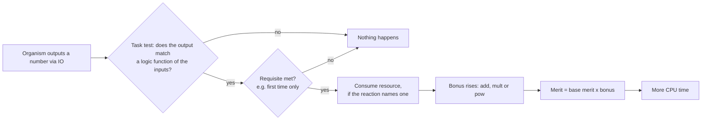

# Environment, tasks and resources

The *environment* decides what behaviour pays. It is described in `environment.cfg` and has three kinds of parts: *tasks* (things an organism can do), *reactions* (what happens when it does one) and *resources* (what a reaction can consume). This page explains how they fit together; the file syntax is in the [environment file reference](../reference/environment-file.md).

## Inputs, outputs and tasks

Each organism has a small list of *input numbers*, three of them in the stock environment. The `IO` instruction does two things at once: it *outputs* the number in a register, and it *reads the next input* into that register. The environment sees every output.

A *task* is a test on an output, given the inputs. The nine classic logic tasks ask whether the output equals a bitwise logic function of one, two or three of the inputs:

| Task name in `environment.cfg` | Output must equal | Using |
|---|---|---|
| `not` | NOT of an input | any one input |
| `nand` | NOT (a AND b) | any two inputs |
| `and` | a AND b | any two inputs |
| `orn` | a OR (NOT b) | any ordered pair of inputs |
| `or` | a OR b | any two inputs |
| `andn` | a AND (NOT b) | any ordered pair of inputs |
| `nor` | NOT (a OR b) | any two inputs |
| `xor` | a XOR b | any two inputs |
| `equ` | NOT (a XOR b), "equals" | any two inputs |

The tests are done on the whole 32-bit number, so an organism cannot guess. It has to produce, with its instruction set, a number that equals the function of the inputs. The easiest function for an organism to build with the stock instruction set is NAND, because `nand` is itself an instruction; EQU is the hardest, because it needs several steps. The stock environment lists the tasks in the order NOT, NAND, AND, ORN, OR, ANDN, NOR, XOR, EQU and pays more for the later ones, on the expectation that they are harder to evolve.

Beyond these nine, the port registers 187 fixed task names (echo, add, sub, all 68 three-input logic functions `logic_3AA` to `logic_3CP`, many one-, two- and three-input arithmetic tasks, Fibonacci tasks, movement and communication tasks, and others) and a further family of tasks that take arguments (string matching, sorting, optimisation, multiplication and others). See the [task list](../reference/tasks.md).

## Reactions: what a task is worth

A *reaction* links a task to a reward. The stock environment has one line per task, for example:

```text
REACTION  EQU  equ   process:value=5.0:type=pow  requisite:max_count=1
```

Read it as: a reaction named `EQU`, triggered by the task `equ`; its *process* gives a reward of type `pow` with value 5; its *requisite* says the reward can be earned only once (`max_count=1`).

The process types:

| Type | Effect on the organism's bonus |
|---|---|
| `add` | The bonus grows by `value`. |
| `mult` | The bonus is multiplied by `value`. |
| `pow` | The bonus is multiplied by 2 to the power `value`. EQU with value 5 therefore multiplies by 32, and NOT (value 1) by 2. |
| `lin` | The bonus grows by `value` times how often the task has been done. |
| `enzyme` | Michaelis-Menten reward that depends on the resource level. |
| `exp` | An exponentially decaying reward with repetition. |
| `energy` | Gives energy rather than bonus; see [the energy model](energy.md). |

Merit is the base merit (about the genome length) multiplied by the bonus. Because `pow` rewards multiply, an organism that does several tasks has a merit far higher than one that does none: in the stock environment the nine values add up to 25 (1, 1, 2, 2, 3, 3, 4, 4 and 5), so doing all nine multiplies merit by 2 to the 25th power, about 33.5 million.

The *requisite* controls when a reaction applies. `max_count=1` restricts it to the first time per life cycle; others include `min_count`, `reaction` and `noreaction` (require or forbid another reaction before it), `min_tot_count` and `max_tot_count`, and `divide_only`. They are listed in the [reference](../reference/environment-file.md#reaction).

## Resources

A task can also *consume a resource*. If a reaction's process names a resource (`resource=glucose`), performing the task takes some of that resource from the world, and the reward scales with how much was available. A reaction with no named resource uses the built-in unlimited resource, so the reward is the same every time; the stock environment works this way.

Resources are what make an environment ecological. If a task depletes its resource, organisms that perform it compete with each other for what is left, and doing a task that nobody else does becomes more profitable. That is the mechanism of [limited resources](../guides/tutorial-limited-resources.md).

The kinds of resource:

| Kind | Where it exists |
|---|---|
| Global | One pool for the whole world, shared by all organisms. |
| Spatial (`geometry=grid` or `torus`) | A separate amount in every cell. It flows in at chosen cells, diffuses, and flows out. |
| Gradient | A spatial resource whose peak moves over time (`GRADIENT_RESOURCE`). Variants include halos, predatory and damaging gradients. |
| Deme | A resource kept per [deme](demes.md). |
| Internal | Held inside the organism and used by instructions. See [internal resources](internal-resources.md). |

A global resource has an *inflow* (units added per update), an *outflow* (the fraction removed per update) and an *initial* amount. If the inflow is 100 and the outflow 0.01, the pool settles at 100 divided by 0.01, which is 10,000 units when nobody consumes it. The `frac` argument of a process is the fraction of the pool one task completion may take, and `max` caps the amount per completion.



The diagram in words: an output is tested against the task. If the test fails, nothing happens. If it passes, the reaction's requisites are checked. If they pass too, the reaction consumes its resource when it names one, raises the organism's bonus by its process type, and the organism's merit becomes the base merit times the bonus. Higher merit buys more CPU time. The steps happen once per output.

## Stepping stones and why tasks are ordered

Many tasks need simpler ones as parts. Rewarding all nine gives evolution a ladder to climb, and rewarding only EQU gives it nothing to select on until a single lucky mutation builds the whole function. The classic experiment that shows this is the first of the [tutorials](../guides/tutorial-stepping-stones.md).

## Next

[The update cycle and scheduling](update-cycle.md).
