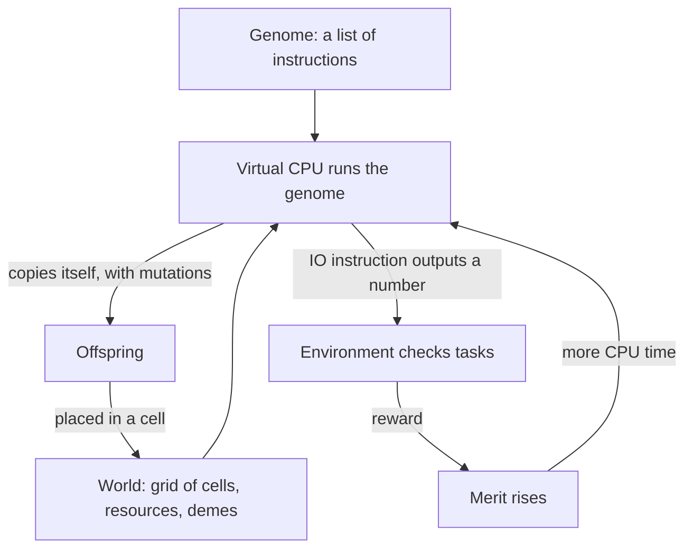

# Concepts

These pages explain how the simulation works. Read them in order if you are new to digital evolution; otherwise pick the topic you need. Each page defines its terms where they first appear, and the [glossary](../reference/glossary.md) collects them.

The diagram in words: an organism's genome is a list of instructions. A virtual CPU executes those instructions, and a well-formed genome copies itself into an offspring, with random mutations along the way. When the organism outputs a number with the `IO` instruction, the environment checks whether the number is the right answer to a task. If so, the organism's merit rises, which gives it more CPU time, which lets it copy itself faster. The offspring goes into a cell of the world, where it competes for space with the others. That loop is the whole evolutionary engine; everything else is a variation on one of its parts.

## The pages

| Page | Topic |
|---|---|
| [Organisms and genomes](organisms-and-genomes.md) | What an organism is, its life cycle, merit, gestation time and fitness. |
| [Virtual CPUs and instruction sets](hardware.md) | The hardware types, the heads CPU in detail, how instruction sets are chosen. |
| [Environment, tasks and resources](environment-and-tasks.md) | Tasks, reactions, rewards, requisites and resources. |
| [Internal resources](internal-resources.md) | Resource bins that organisms fill with collect instructions and spend on reactions. |
| [The update cycle and scheduling](update-cycle.md) | How CPU time is shared and what an update is. |
| [Reproduction, birth and sex](reproduction.md) | Where offspring go, death, and sexual reproduction. |
| [Mating types and mate choice](mating-types.md) | Separate sexes, the birth chamber, mate preferences, displays and costs. |
| [Mutations](mutations.md) | The kinds of mutation and the settings that control them. |
| [Demes](demes.md) | Subpopulations that replicate and compete as groups. |
| [Parasites](parasites.md) | Parasite threads that infect hosts. |
| [Predator and prey](predator-prey.md) | Predator and prey organisms on the experimental hardware. |
| [The energy model](energy.md) | Organisms that spend energy to run instructions. |
| [Systematics and genotypes](systematics.md) | How the program groups organisms into genotypes and tracks ancestry. |
