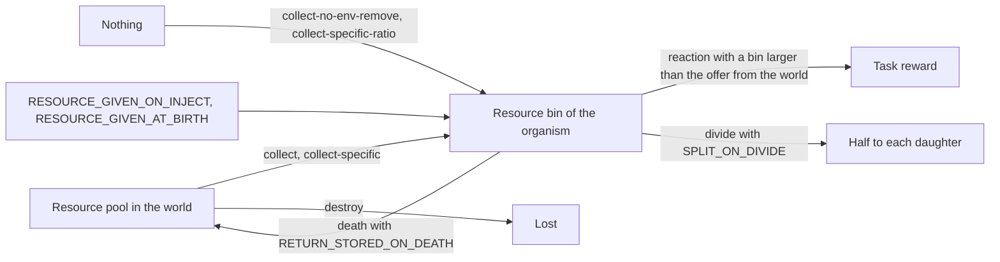

# Internal resources

Avida lets an organism take a resource out of the world and keep it in a private store, a set of *resource bins* with one bin for each resource of the environment. An organism can then pay for a reaction from its bins instead of from the world, hand half of its store to each offspring, and give its store back to the world when it dies. This page explains how the store fills, how it is used and where it goes.

Everything here needs `USE_RESOURCE_BINS 1`. The setting is a guard: with the stock value 0 the collect instructions still run, but no bin is ever read by the reaction code and no bin is returned at death. The other settings are in the [HOARD_RESOURCE_GROUP of the settings reference](../reference/settings.md#hoard_resource_group).

## The life of a bin



The diagram in words: a bin is filled by a collect instruction (which usually takes the amount from the world's pool, but some variants add to the bin without taking anything) or by the two `RESOURCE_GIVEN_*` settings when an organism is injected or born. A bin is emptied when a reaction uses it, when the organism divides (each daughter receives half if `SPLIT_ON_DIVIDE` is 1, and the bin is cleared otherwise) and when the organism dies (the content goes back into the world's pool if `RETURN_STORED_ON_DEATH` is 1, and is lost otherwise). `destroy` takes resource out of the world without storing it.

## Collecting

The collect instructions are in the stock instruction-set library but not in the stock instruction sets, so you add the ones you want to your `instset-*.cfg` file with an `INST` line. They were run on the heads CPU (hardware type 0). A resource is "the resource the instruction picks" as the next section explains.

| Instruction | Takes from the world | Adds to the bin | Amount |
|---|---|---|---|
| `collect` | yes | yes | `ABSORB_RESOURCE_FRACTION` of what the world holds. |
| `collect-no-env-remove` | no | yes | The same amount as `collect` would take, so it creates resource. |
| `destroy` | yes | no | The same amount as `collect` would take. |
| `nop-collect` | no | no | Nothing. It reads a label like `collect`, so it is the fair control for a comparison. |
| `collect-unit-prob` | yes | yes | Exactly 1 unit, or nothing: the instruction fails with probability 1 minus (amount in the world divided by `COLLECT_PROB_DIVISOR`), so it fails more often as the resource gets scarce. |
| `collect-specific` | yes | yes | `ABSORB_RESOURCE_FRACTION` of the resource numbered `COLLECT_SPECIFIC_RESOURCE`. It reads no label. The amount collected goes into `?BX?`. |
| `collect-specific-ratio` | no | yes | One unit of every resource, scaled by `COLLECT_AMOUNT` and by the ratios of `NON_1_RESOURCE_RATIOS`. |
| `collect-needed` | no | yes | One probabilistic unit of the resource whose number is the opcode of the instruction under the read head. |

Six of these were checked by a run of a 3600-organism world in which every organism executed the instruction once: `collect` and `collect-specific` each reduced a resource of 10,000 units to 1.22 (each organism takes 0.25 percent of what is left, and 10,000 times 0.9975 to the power 3600 is about 1.2), `collect-no-env-remove` and `nop-collect` left the world untouched, and `destroy` reduced it exactly as `collect` does. `collect-unit-prob` with `COLLECT_PROB_DIVISOR 20000` took 1,620 units out of 10,000, which fits a success probability that starts at one half and falls to 0.42. The last two rows of the table are read from the code.

Two details differ from the old wiki. The default of `COLLECT_PROB_DIVISOR` in the port is 1, not 1000, so set it yourself when you use the probabilistic instructions. And `collect-specific` ignores `COLLECT_AMOUNT` on the heads CPU: it takes a fraction like `collect`. `COLLECT_AMOUNT` governs `collect-specific-ratio` and `collect-needed`.

`MAX_TOTAL_STORED` caps the sum of all bins of one organism. With -1 (the stock value) there is no cap. When a collect would pass the cap, the instruction still succeeds but adds nothing, and takes nothing from the world.

### Which resource an instruction picks

`collect`, `collect-no-env-remove`, `destroy`, `nop-collect` and `collect-unit-prob` read the nops that follow them as a label. Let N be the number of nop instructions in the instruction set and R the number of resources in the environment. The instruction reads at most ceil(log R / log N) nops. Each nop narrows the range of resources the instruction may pick, and the instruction then draws uniformly inside the range. The nops are consumed, so the instruction pointer moves past them.

For the usual case of 3 nops (`nop-A`, `nop-B`, `nop-C`) and 9 resources, numbered from 0 in the order they appear in the environment file:

| Label after the instruction | Resources it may pick |
|---|---|
| none | 0 to 8, drawn at random |
| `nop-A` | 0 to 2 |
| `nop-B` | 3 to 5 |
| `nop-C` | 6 to 8 |
| `nop-A nop-A` | 0 |
| `nop-A nop-B` | 1 |
| `nop-B nop-A` | 3 |
| two nops `x y` in general | resource 3x + y, with A = 0, B = 1, C = 2 |

A run of the suite configuration `collect-spec-3n9r-AB` confirmed the row for `nop-A nop-B`: after one update, resource 1 (the second one declared) was down to 1.22 units and the other eight were untouched. With a different number of nops or resources the same rule applies with other numbers. The label of `collect-specific` is not read, which is the reason the instruction exists: its resource is fixed by the setting.

## Using bins to pay for reactions

When an organism completes a task, the environment decides where the reward's resource comes from. With `USE_RESOURCE_BINS 1` and a reaction that consumes a resource, the organism uses its bin instead of the world's pool when both of these hold: the bin is not empty, and

```text
USE_STORED_FRACTION * bin  >  ENV_FRACTION_THRESHOLD * (what the world would give)
```

What the world would give is its amount multiplied by the `frac` of the reaction's process, before the cap by `max` is applied. When the bin is used, the amount consumed is `USE_STORED_FRACTION` of the bin, which the cap by `max` then limits like any other consumption. The stock value 1.0 therefore spends the whole bin, up to that cap.

A reaction can also be bound to the bins directly with the `internal=1` option of its `process:` entry (see the [environment file reference](../reference/environment-file.md#process-options)). It then consumes from the bin only and never from the world.

Tasks that were paid from a bin are counted separately. `PrintInternalTasksData` writes `in_tasks.dat` (the number of organisms that perform each task with internal resources, one column per task) and `PrintInternalTasksQualData` writes `in_tasks_quality.dat`. In the analyze mode data entries `r_avail.N` and `r_tot.N` read the bin content (the resource that is available now, and the total ever collected) of resource N, but a genotype in the test CPU has no resources to collect, so they show zero there.

### Forcing the use of bins

To make a population depend on the bins, make the world look empty to the reaction rule and also set the reaction's `frac` to 0:

```text
ENV_FRACTION_THRESHOLD 0.0
```

```text
REACTION NOT not process:resource=resNOT:value=1.0:frac=0.0:max=25
```

Now any non-empty bin beats the offer of the world, and with `frac` at 0 the world offers nothing, so a reaction is paid only from a bin. An organism that does not collect gets no reward.

A run of the suite configuration `hoarding_collect_internal_300u` for 60 updates (seed 116; its events file lists `PrintStatsData`, which the port does not have, so that line was removed) gave these totals of `in_tasks.dat` against `tasks.dat`, summed over the nine tasks:

| Setting | Organisms credited with a task | Of which paid from a bin |
|---|---|---|
| `USE_RESOURCE_BINS 0` | 6,321 | 0 |
| Stock bin rule (`frac` 0.0025) | 3,030 | 2,574 |
| Bin rule forced, as above (`ENV_FRACTION_THRESHOLD 0.0` and `frac=0.0`) | 2,496 | 2,296 |

The runs show that `in_tasks.dat` fills only when bins are on, and that forcing the bins raises the share of credited tasks that were paid from a bin from 85 to 92 percent. The totals come from one seed each, and a different rule changes the whole run, so read them as an illustration and not as a measurement. A task is counted in `tasks.dat` whenever it is completed, whether or not its reaction was paid, which is why the two columns do not coincide even when only bins can pay.

## Sources and sinks in the settings

| Setting | Stock | Effect |
|---|---|---|
| `RESOURCE_GIVEN_ON_INJECT` | 0.0 | Units of the `COLLECT_SPECIFIC_RESOURCE` resource that an injected organism starts with. |
| `RESOURCE_GIVEN_AT_BIRTH` | 0.0 | Units of the same resource that a newborn receives, on top of what it inherits. |
| `SPLIT_ON_DIVIDE` | 1 | The mother's bins are halved at divide and each daughter takes half. With 0 the bins of the mother are emptied and the daughters start empty (after the `RESOURCE_GIVEN_AT_BIRTH` gift). The old wiki warned that this was only tested with `DIVIDE_METHOD 1`. |
| `RETURN_STORED_ON_DEATH` | 1 | The bins of a dying organism go back into the world's resources. With 0 they are lost. The old wiki warned that this was only tested for death by old age and by replacement. |
| `MULTI_ABSORB_TYPE` | 0 | Used by `collect-edible` on the experimental hardware only. The heads CPU `collect` ignores it. |

## Next

[Environment, tasks and resources](environment-and-tasks.md) describes the pools the bins draw from, and the [settings reference](../reference/settings.md#hoard_resource_group) has the full list of hoarding settings.
