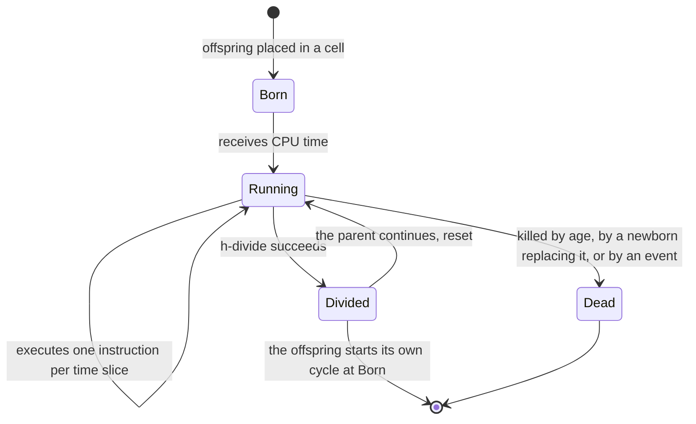

# Organisms and genomes

An *organism* in Avida is a program together with a virtual CPU that runs it. The program is the organism's *genome*: a list of instructions, each one drawn from the *instruction set* of the experiment. Organisms live in the cells of a grid, at most one per cell.

## The ancestor

A run starts empty. The events file injects the first organism, the *ancestor*, from a file with the extension `.org`. In the stock configuration the ancestor is `default-heads.org`: 100 instructions long, of which 14 do the work and 86 are the do-nothing instruction `nop-C`. Its structure is:

1. `h-alloc` allocates room for an offspring genome.
2. `h-search` finds where the genome ends, and a few instructions set up the write position of the copy.
3. A long run of 86 `nop-C` instructions does nothing; it is padding that gives the genome its length of 100 and room for evolution to work with.
4. A copy loop: `h-search` marks the start of the loop, `h-copy` copies one instruction, `if-label` tests whether the copy is complete, `h-divide` ends the cycle by cutting the offspring off, and `mov-head` jumps back to the start of the loop.

The ancestor does no logic tasks. It copies itself, with occasional mistakes, and everything else evolves.

## Life cycle

An organism passes through the same stages over and over:

In words: an organism is born into a cell and starts receiving CPU time. At each time slice it executes one instruction of its genome. When its genome has copied itself and executes the divide instruction, a copy of the genome (the offspring) is cut off and placed in a cell chosen by the birth rules, and the parent restarts its cycle. An organism dies when it grows too old, when another organism's offspring replaces it, or when an event kills it.

- Age limit: with the stock setting `DEATH_METHOD 2`, an organism dies after it has executed `AGE_LIMIT` (20) times its own genome length in instructions. This removes organisms that never divide.
- `DIVIDE_METHOD 1` (the default) resets the parent at division, so that both parent and offspring begin a new cycle. See [reproduction](reproduction.md).

## Phenotype: what the organism has achieved

The *phenotype* is everything measured about an organism's behaviour, as opposed to its genome. The quantities you will see most often:

| Quantity | Meaning |
|---|---|
| Gestation time | The number of CPU cycles the organism needed to produce its last offspring. |
| Merit | The organism's claim on CPU time. It starts from the genome's size and is multiplied by the rewards of tasks the organism performed. |
| Fitness | Merit divided by gestation time: how fast the organism turns CPU time into offspring. This is what natural selection acts on in Avida. |
| Generation | The number of replication steps between the organism and the first ancestor. |
| Age | Updates the organism has lived. |
| Copied size, executed size | How many instructions of the genome the organism copied and executed. |

You can check the relation for the ancestor on a real run: in `average.dat` of the first stock run, row 0 reads merit 97 and gestation time 389, and the fitness printed in the progress lines is 0.2494 (97 divided by 389). The base merit follows `BASE_MERIT_METHOD`; the stock value 4 makes it proportional to the smaller of the copied and the executed size.

## Genotype and species

A *genotype* is a group of organisms with identical genomes. Many organisms share one genotype in a population. The program counts and tracks genotypes (see [systematics](systematics.md)), and the `Genotypes` views of the [front ends](../front-ends/index.md) list them by abundance.

## Why "digital evolution"

Everything that evolution needs is present: heredity (the offspring's genome is a copy of the parent's), variation (mutation), and differential reproduction (organisms that earn more merit run faster and place more offspring). Nothing in the program tells organisms to do logic. They do logic because the environment pays for it. The [tutorials](../guides/index.md) are experiments that vary what is paid for.

## Next

[Virtual CPUs and instruction sets](hardware.md).
