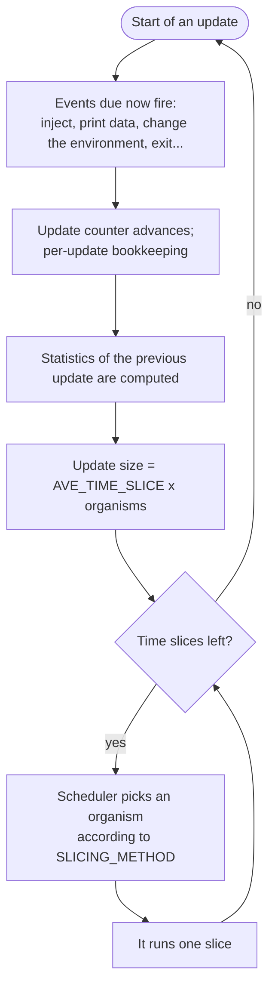

# The update cycle and scheduling

Avida measures time in *updates*. This page explains what happens in one update and how the virtual CPU time is shared out among the organisms, because that sharing is the strongest lever on what evolves.

## Time slices and updates

The unit of computation is the *time slice*: one organism gets to run for a slice (in the default exact mode, one instruction). An *update* is a fixed number of time slices:

> update size = `AVE_TIME_SLICE` x the number of organisms alive at the start of the update

With the stock `AVE_TIME_SLICE 30`, one update gives each organism 30 time slices on average. You can see this in `count.dat` (column 2, "number of insts executed this update"): in a population of 3,598 organisms the value is 107,910, which is 30 per organism.

Because the update size follows the population, an update means "the time it takes the average organism to run about 30 instructions", whatever the population size. An ancestor needs about 389 cycles for one gestation, so about 13 updates pass per generation of the first organism. Later, as organisms evolve to copy faster, generations take fewer updates.

## What an update does

The diagram in words: an update begins by running the events that are due, then advances the update counter and finishes the statistics of the update that just ended. It then works out its size and hands out that many time slices, one at a time, each to an organism the scheduler chooses. When the slices are used up, the next update starts. During a slice an organism may divide, which places an offspring in a cell, possibly replacing a living organism; a data-printing event writes a line for the moment it fires.

Events are the way to schedule anything: see the [events file](../reference/events-file.md). The trigger letters are `u` (update), `g` (generation), `i` (immediate), `b` (births) and `o` (organism id), the last two being less common.

## Who gets the time: `SLICING_METHOD`

| Value | Name | Behaviour |
|---|---|---|
| 0 | Constant | Every organism receives the same number of cycles. Merit has no influence on speed. |
| 1 | Probabilistic (the default) | Each slice goes to an organism chosen at random with probability proportional to its merit. |
| 2 | Integrated | Deterministic: organisms receive cycles in proportion to their merit, without chance. |
| 3, 4 | Deme probabilistic, cross-deme probabilistic | The setting's description lists them, but no scheduler is built for them: the C++ program crashes at start-up, and the port stops with `unsupported: SLICING_METHOD 3` (or 4) instead. |
| 5 | Probabilistic integrated | A merit-weighted lottery with an integrated component; `SLICING_BURST_SIZE` sets its burst size. Not listed in the setting's description, but the scheduler exists and the parallel mode treats it as a lottery method. |

Merit is what turns task rewards into evolutionary advantage: an organism with twice the merit of its neighbour runs twice as often and so copies itself twice as fast.

## Generations, Avida time, and the other clocks

- **Generation**: the replication distance from the first ancestor. `g` events count generations of the average organism.
- **Avida time** (`time.dat`, column 2): a time scale of its own that `PrintTimeData` records beside the update and the generation.
- **Time used**, **age**: per-organism counters, in CPU cycles or updates, used by age-limited death and by deme replication.

## Speculative execution

`SPECULATIVE 1` (the default) lets the program run ahead several instructions of an organism's slice when those instructions cannot affect any other organism, which makes runs faster. It is meant not to change what is computed, so leave it at its default unless you have a reason. The two execution modes are described on [execution modes](../execution/index.md).

## Threads inside an organism

An organism can have several CPU *threads* on hardware that supports them. `MAX_CPU_THREADS` bounds the number, and `THREAD_SLICING_METHOD` chooses whether one thread (0) or all (1) execute per time slice. Parasites are threads; see [parasites](parasites.md).

## Next

[Reproduction, birth and sex](reproduction.md).
