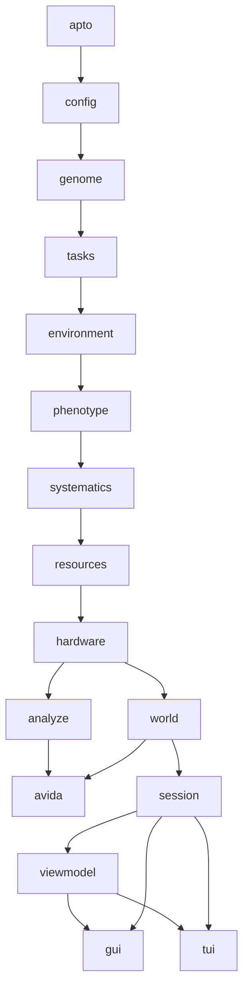

# Architecture

The native Rust port is a Cargo workspace of 17 crates in `rust/avida-native/crates`. Each crate may depend only on crates listed before it in the layer table below. The full table, the status of each crate and the ownership model are in `rust/avida-native/ARCHITECTURE.md`; this page gives the shape of it.

## Layers

| Layer | Crate (package) | Role |
|---|---|---|
| 1 | `apto` (`avida-apto`) | Random number generator, schedulers, `%g`-style number formatting, the data-file writer, running statistics. |
| 2 | `config` (`avida-config`) | The configuration table (`avida.cfg` settings), the init-file reader, string utilities, the command line. |
| 3 | `genome` (`avida-genome`) | Instructions, instruction sequences, genomes, instruction sets and the instruction-set registry. |
| 4 | `tasks` (`avida-tasks`) | The task library and its evaluators. |
| 5 | `environment` (`avida-environment`) | Resources, reactions and the environment-file parser and evaluation. |
| 6 | `phenotype` (`avida-phenotype`) | Merit, mutation rates, the phenotype data. |
| 7 | `systematics` (`avida-systematics`) | The genotype arbiter, groups and the `.spop` writer. |
| 8 | `resources` (`avida-resources`) | Resource counts: global, spatial and gradient. |
| 9 | `hardware` (`avida-hardware`) | The organism, every CPU type and the test CPU. |
| 10 | `script` (`avida-script`) | The ASL scripting language: lexer, parser, semantic analysis and interpreter. |
| 11 | `analyze` (`avida-analyze`) | The analyze-mode command loop, batches, landscapes. |
| 12 | `world` (`avida-world`) | Cells, demes, population, birth chamber, statistics, actions, events, set-up and the driver; also the parallel execution mode. |
| 13 | `avida` | The command-line binary. |
| 14 | `viewmodel` (`avida-viewmodel`) | Read-only snapshots of a world for front ends. |
| 15 | `session` (`avida-session`) | A world on its own thread, driven by commands, with speed control and the debugger. |
| 16 | `gui` (`avida-gui`), `tui` (`avida-tui`) | The two viewers. |

The diagram in words: the foundation crates (`apto`, `config`, `genome`, `tasks`, `environment`, `phenotype`, `systematics`, `resources`) each build on the ones before. `hardware` sits above them. `analyze` and `world` both build on `hardware`, and the `avida` binary uses both. The viewers are separate: `session` wraps a `world` on a thread, `viewmodel` produces snapshots from it, and `gui` and `tui` use those two and never touch `world` directly. (The diagram is a simplification of the dependency rules; it leaves out edges that go from any crate to any crate below it, and `script`, which depends only on `apto` and `config`.)

## The ownership model in brief

The C++ program is a graph of pointers: world, population, cell, organism, hardware, interface. The port replaces it with three rules:

1. **Ids, not pointers.** Cells, demes, organisms, genotypes and resources are referred to by integer ids that index arenas owned by the world.
2. **An organism is state plus hardware, borrowed separately.** `Organism { state, hardware }`, and the hardware's methods take the state and the world interface as arguments.
3. **The running organism is taken out of its cell** while it runs, and put back afterwards unless it was marked for deletion. Code that would have touched the running organism through the population goes through the references it was handed.

`ARCHITECTURE.md` explains each with the C++ behaviour it mirrors.

## Adding things

| To add | Read |
|---|---|
| An instruction | The instruction library table of the hardware type (for the heads CPU, `crates/hardware/src/cpu_inst_lib.rs`) and its handlers in `hardware_cpu_insts*.rs`. A handler must consume its nop modifiers in the C++'s order. Instruction-set files then list it with an `INST` line. |
| A task | `crates/tasks/src/registry_table.rs` (fixed tasks), `task_lib.rs` (tasks with arguments) and the evaluators in `eval_*.rs`. A task the C++ does not have needs the maintainer's decision and a note in `PORTING.md`. |
| A setting | `crates/config/src/config_table.rs` is generated from the C++ header; a setting that only the port has goes in `crates/config/src/port_settings.rs`. |
| An action | `crates/world/src/action_library.rs` (names and argument text) and the action's implementation under `crates/world/src`. |
| A map layer or a viewer feature | `crates/viewmodel` (the snapshot), then `gui` and `tui` through `session`. |
