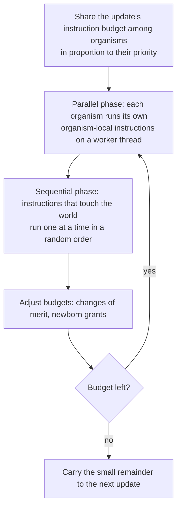

# Execution modes

The simulation engine can run an update in two ways. The *exact mode* is the default and reproduces the C++ program exactly. The *parallel mode* is opt-in, runs many organisms' instructions on several threads, and gives up byte-identical output in exchange for speed.

## What "parity with the C++" means

The Rust port is meant to be a drop-in replacement for the C++ Avida. In the exact mode, for the same configuration and random seed, every output file matches the file the C++ program writes, byte for byte. That is a strong claim, and it explains some choices you will see in this documentation:

- The random number generator, the order in which random numbers are drawn, integer overflow behaviour and floating-point rounding follow the C++ program, including where the C++ program does not fuse a multiplication and an addition.
- Quirks of the C++ program that affect output are kept, and marked in the code.
- A feature that is not ported stops with `unsupported:` rather than running differently ([unsupported features](../reference/unsupported.md)).
- The only approved departure from parity is the parallel mode below.

Parity is checked against a reference binary built from the git tag `cpp-final` with a suite of 121 configurations taken from the original program. The last measurement, recorded in the repository's `ARCHITECTURE.md`: 85 outputs byte-identical, 34 failing in the same way as the C++ program does, none different, one stopping on a named unported feature, one where the reference binary times out. See [how parity is tested](../contributing/parity.md).

## Choosing a mode

| | Exact mode (`EXECUTION_MODE 0`) | Parallel mode (`EXECUTION_MODE 1`) |
|---|---|---|
| Default | Yes | No, opt-in |
| Output equals the C++ program's | Yes, byte for byte | No, by design |
| Same seed gives the same run | Yes | Yes, for a given configuration and seed, whatever the number of threads or the machine's load |
| Speed | The C++ program's speed or a little better | About 2.6 times faster on four threads in one measurement (below) |
| Hardware types that gain | All run | The heads CPU only |
| Use for | Reproducing published results, checking a change, anything you will compare with C++ output | Long exploratory runs on a large world with the heads CPU |

Turn the parallel mode on in `avida.cfg` or on the command line:

```sh
avida -s 7 -set EXECUTION_MODE 1 -set EXECUTION_THREADS 4
```

`EXECUTION_THREADS` is the number of worker threads; 0 (the default) or less means every core the machine reports. Any value of `EXECUTION_MODE` other than 0 and 1 stops at start-up.

## How an update differs in the parallel mode

In the exact mode each time slice runs one instruction of one organism, chosen by the scheduler. In the parallel mode, an update works through rounds:



The diagram in words: the update's instructions are divided among organisms by priority (merit). In the parallel phase each organism runs, on a worker thread, as many instructions as it can that affect only itself (no-operations, conditionals, flow control, stacks, registers, arithmetic, head movement, copying, allocation, search). It stops at its first instruction that touches anything else, such as `IO` or `h-divide`. In the sequential phase the stopped organisms run that one instruction through the same code path as the exact mode, in a random order. Budgets are then adjusted (an organism whose merit changed, a newborn getting a share) and the cycle repeats until the budget is used up. A small difference between planned and executed instructions carries over to the next update, so the run executes the same total as the exact mode.

Under the lottery slicing methods (`SLICING_METHOD` 1, the default, and 5), each organism's budget is a Poisson draw whose mean is its share, because that is what a lottery over the update's time slices would give it. Exact shares under a lottery method made empty cells stay empty longer.

## What the parallel mode guarantees

- A run is a function of its configuration and seed. The number of threads and the load on the machine do not change a byte of the output. (A check for this page: the same 300-update run with 1 and with 2 threads gave identical data files; only the date line in the headers differed.)
- Every instruction runs the same handler as in the exact mode. Only the order in which organisms' instructions interleave within an update, and the random streams, differ.
- The exact mode is untouched by the parallel code. The whole consistency suite stays byte-identical.
- The outcomes match the exact mode statistically. In a comparison over 16 seeds per mode, 5,000 updates of the stock configuration, the medians of nine outcomes (average fitness, genome length, tasks held by at least 5% of organisms, the first update with NOT and with NAND, generation, gestation time, organism count and instructions in the last update) did not differ significantly after the Poisson budgets were introduced (all p values at least 0.27 in the maintainers' latest comparison). An earlier comparison had found slightly fewer organisms in the parallel mode (p = 0.031) and traced it to deterministic budgets, which keep related organisms in phase; that is why the budgets are random.

## What it does not guarantee

- **No byte parity** with the C++ program or with the exact mode, for any seed. The runs diverge from the first mutation, because random numbers are drawn in a different order.
- **The interleaving within an update.** Organisms do not take turns of one instruction.
- **Per-update instruction counts** (`count.dat`, column 2) vary by the carry-over, a few percent of an update. The run total does not.
- **Demes**: a deme whose bursts cross a replication threshold replicates at the end of that round, and a deme generation takes about one update longer than in the exact mode (1.5% to 3% longer under three of the four triggers measured; with `DEMES_REPLICATE_TIME`, about 7% fewer births).
- **Speculative statistics** of the status line read zero and `SPECULATIVE` is ignored. The front ends' debugger steps whole updates.
- **`SetConfig EXECUTION_MODE`** during a run has no effect; the mode is read when the run starts.
- A small difference in births per update from a common start (173.4 against 176.3) remains.

## Where it gains nothing

These run every instruction through the sequential phase, so they are not faster: hardware types other than the heads CPU (TransSMT and its parasites, experimental, GP8, BCR), organisms with a tracer or a mini, micro, navigation or reproduction trace, `THREAD_SLICING_METHOD 1`, promoters, constitutive regulation, implicit reproduction, instructions with resource costs, runs at `VERBOSITY` 3 or more, and runs with `TASK_SWITCH_PENALTY`. Nothing is rejected at start-up; the run just does not speed up.

## Speed

One measurement from the maintainers, on an Apple M1 Pro (8 performance and 2 efficiency cores) with nothing else computing: the stock configuration, seed 42, 3,000 updates, release build.

| Run | Wall time | Against exact |
|---|---|---|
| Exact mode | 47.2 s | 1.0 |
| Parallel, 1 thread | 28.6 s | 1.65 |
| Parallel, 2 threads | 21.0 s | 2.25 |
| Parallel, 4 threads | 18.1 s | 2.61 |
| Parallel, 8 threads | 18.1 s | 2.61 |

The four parallel runs wrote identical files. Later work (2026-11-13) moved output tests and divides into the parallel phase for environments without resources or with only per-cell (spatial) resources, which brought the four-thread run to 13–15 s; eight threads gain only about 10% more, because placing offspring and gathering statistics remain sequential. A shared machine is much slower: with other processes on every core, an 8-thread run took 91 s in one test.

**Running many replicate seeds at once.** When the cores are busy with other runs anyway, use `EXECUTION_THREADS 1`: it keeps the single-thread gain (1.65 times in the table) without the contention between pools. The program's own statistics tool runs the parallel mode that way.

## Diagnostics

`AVIDA_EXECUTION_STATS=1` in the environment makes the parallel mode print one line to standard error at the end of the run: rounds per update, the share of instructions run in the sequential phase, the grants and rescales, the carry-over, the bursts, and the time per phase. A real example from a 300-update run with 2 threads:

```text
parallel mode: 301 updates, 8.3 rounds/update (max 23), 9058 instructions/update (0.66% sequential, 2.20% newborn grants, 1 rescales/update, carry-over 355), 370 bursts/update (29.0% inline); time in updates 0.122 s: allocation 9.4%, parallel phases 58.8%, sequential phases 31.7%
```

It is not a C++ output.

## Related

- The design is written out in `rust/avida-native/ARCHITECTURE.md`, section "Parallel execution mode", and the rule that allows the departure in `rust/avida-native/PORTING.md`, in the repository. See [for contributors](../contributing/index.md).
