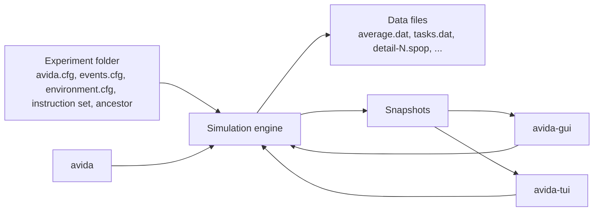

# The three front ends

Avida comes as three programs. They run the same simulation engine and read the same configuration files, so an experiment folder works with all of them.

| Program | Interface | Best for |
|---|---|---|
| [`avida`](cli.md) | Command line | Batch runs, many seeds, scripted experiments, analyze mode. Output goes to data files. |
| [`avida-gui`](gui.md) | Desktop window (egui) | Watching a run, inspecting organisms, comparing layers on the map, charts, exporting images and CSV. |
| [`avida-tui`](tui.md) | Terminal (ratatui) | Watching a run over `ssh`, or on a machine without a display. |

The two viewers (`avida-gui` and `avida-tui`) run the simulation on a thread of their own and show snapshots of it. They add no new simulation features: anything you can do in a viewer you can do with `avida` and an events file. A viewer reads its settings from the experiment folder and accepts the same `-s SEED` and `-set NAME VALUE` arguments as `avida`.

The diagram in words: the experiment folder feeds the simulation engine. The `avida` program drives the engine directly, and writes data files. The two viewers also drive the engine (run, pause, step, restart) and receive read-only snapshots of its state to draw. Only the engine writes data files, so a viewer and `avida` produce the same files for the same events file.

## Which should I use?

- Start with `avida-tui` or `avida-gui` to see what a configuration does, then switch to `avida` for the production runs.
- Use `avida` for any run you want to repeat many times or run in the background.
- Use `avida -a` (analyze mode) for post-hoc analysis of saved populations. Analyze mode is not part of the viewers; the terminal interface says so if you press `A`.

## What the viewers do not do

- A single long simulation step cannot be interrupted. When you close a viewer in the middle of one, it waits briefly and then detaches the simulation thread (2 seconds for the desktop application; 3 seconds for the terminal interface).
- The viewers were checked from rendered screenshots and text dumps of every screen, and by automated tests (including terminal tests for signals and hang-up). They have not yet been judged by a person in a real window or terminal, so rough edges are likely; please report them.
